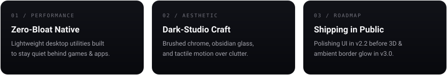

  

 

  

 

  

 

### Stack & Current Focus

| Area | Stack |
| :--- | :--- |
| **Desktop & Core** | `C#` `.NET 10` `WPF` `Win32 / SMTC` |
| **Scripting & Databases** | `Python` `SQL` `MySQL` `Oracle` |
| **Web & Frontend** | `HTML5` `CSS3` `JavaScript` `PHP` |
| **Roadmap** | `v2.1.1` Live &rarr; `v2.2` Chrome UI &amp; Tray Overhaul &rarr; `v3.0` 3D &amp; Ambient Glow |

 

  
  
  

